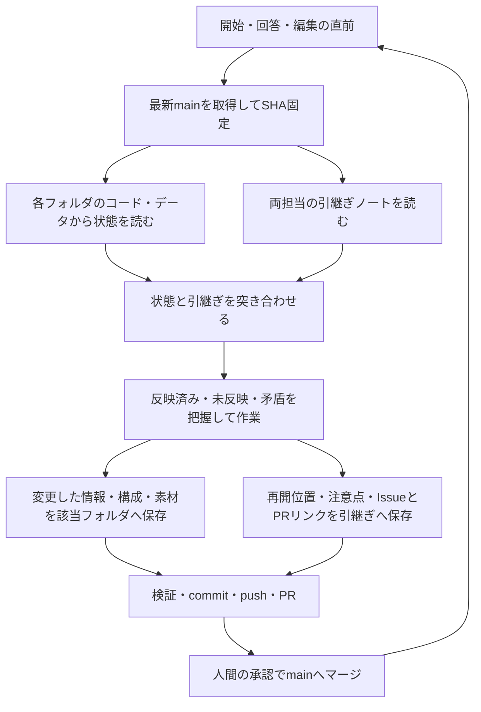

# 状態と引継ぎの共通取得

状態把握はコード・実データのみ。ノートは引継ぎのみ。両方を同じ最新main SHAから取得し、突き合わせる。手動の状態管理ノートや別の現在情報台帳は作らない。

## GitHubの標準運用に合わせる

| 情報 | 保存先 |
| --- | --- |
| 現在の実装・学校情報・構成・素材 | 各フォルダのコード・実データ |
| 未完了の課題・不具合・判断待ち | GitHub Issue |
| 提案する変更・変更理由・レビュー・承認・検証結果 | GitHub PRとcommit |
| 次の担当に必要な再開位置・注意点 | 自分の引継ぎノート。関連Issue/PRをリンク |

引継ぎノートへIssue/PRの議論や判断履歴を複製し続けない。新しいADR・台帳・自動通知は導入しない。共通取得CLIとcacheはGit実データを読む補助であり、GitHubの課題管理や履歴を置き換えない。Issue/PRのAPIが利用できないときは作業ブランチを保全し、未登録と報告する。ノートを代替課題台帳へ転用しない。



CodexもClaude Codeも、開始・事実回答・編集・マージ提案の直前にリポジトリルートで実行する。

```bash
python3 system/scripts/sync-context.py
```

## 読む順序

1. 生成manifestの取得時刻・main SHA・成功状態を確認する。失敗やofflineなら最新確認済みとは言わない。
2. `.cache/session-context/state-context.md` を読み、各フォルダのコードと実データから状態を把握する。根拠はcompany-dataのYAML、booksのconfig・ページ定義・HTML/CSS、referencesの出典・分析・原本の追跡情報、sharedの素材・生成記録。追加の本文はコマンドの `--source` で読む。README・ノートの記述で存在や完成を決めない。
3. `.cache/session-context/handoff.md` を読む。これは両担当の引継ぎ全文であり、再開位置・未反映事項・注意点を知るために使う。課題の詳細はIssue、変更理由とレビューはPRを参照する。過去ノートの判断履歴を状態の代わりにはしない。
4. 状態と引継ぎを突き合わせ、反映済み・未反映・矛盾・観測不足を区別して報告する。

例: コードの募集要項が2027年で、引継ぎが2028年向け冊子の指示なら「2028年の指示あり、コードへの年度反映は未完了」。写真件数は写真登録と追跡画像を直接確認する。ノートに作成済みとあってもmainにBOOKが無ければ「main未反映」。原本の追跡存在は実体読込・画像目視・描画成功とは別。

## 書く場所とタイミング

- 学校の確定情報はcompany-data、ページ構成と制作状態はbooks、原本と分析はreferences、素材と生成記録はsharedの既存形式へ保存する。複製した状態台帳は作らない。
- 開始・終了時に、自分の引継ぎノートへ再開位置・注意点・次の一手と関連Issue/PRリンクを短く書く。変更理由・レビュー・検証はPRへ記録する。相手のノートは読むだけ。
- コードへ未反映の確定事項は未反映と記録し、適切なフォルダへの反映を作業として扱う。ノートだけで反映済みとは言わない。
- commit/push後もmain未マージ。人間の明示承認でマージ後、両担当が同じコマンドで実コードと引継ぎを再取得する。

コマンドは最新mainの固定SHAを読み、作業ブランチや未保存変更は動かさない。生成物は.cacheに保存し追跡しない。常駐監視・自動通知・相手の既読保証はない。取得後にmainが進むことがあるため判断の直前に再取得する。
